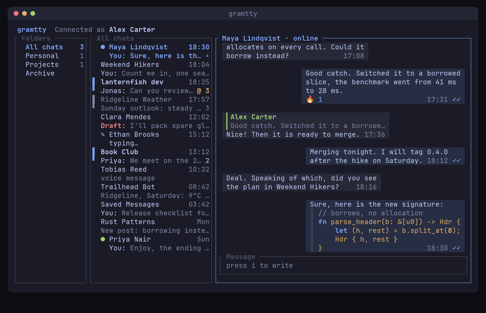

[Русский](README.ru.md)

# gramtty



Terminal Telegram client in Rust on TDLib.

## Contents

- [Features](#features)
- [Installation](#installation)
- [Runtime tools](#runtime-tools)
- [Telegram API credentials](#telegram-api-credentials)
- [First login](#first-login)
- [Key bindings](#key-bindings)
- [Configuration](#configuration)
- [License](#license)

## Features

- Login by QR code, phone number, login code, email code and 2FA password
- Chats, folders, forum topics, secret chats
- Chat list in two lines per chat, as in Telegram: the last message with its sender and time, drafts and who is typing; one line per chat with `appearance.compact_chat_list`. On a narrow terminal the chat info pane steps aside until you focus it (`4`), and `j` `k` scroll it when it is focused
- Inline media in the terminal: photos, albums, video, video notes, stickers, voice, files (kitty graphics; sixel, iTerm2 and half-block fallbacks); animated stickers and GIFs play right in the chat and in the sticker/GIF picker (natively in kitty; in sixel, iTerm2 and half-block terminals they are redrawn at up to 12 fps, at most 2 at a time in the chat, within about 1 MB/s of terminal output); video, video notes, GIFs, voice and music play with sound inside the viewer in kitty (libmpv), or in a separate mpv window
- Sending: files, albums, clipboard paste, voice messages, stickers and GIFs; upload progress and cancel
- Reactions, replies, edit, delete, forward, pin, copy, translate, save to Saved Messages
- Search like in Telegram: chats, contacts, public channels and messages in one box; search in a chat with highlighted matches, media filters, jump to a date and `n`/`N` stepping; pinned messages, notification inbox
- Jumps to the next unread chat, mention or reply, reaction
- Bot commands and inline keyboard buttons
- t.me links and @mentions open users, bots, channels, groups and messages right in gramtty; joining by an invite link and sending /start from a bot link ask first
- Desktop notifications and a notification sound
- Formatting as you type: bold, italic, underline, strikethrough, spoiler, code, links and quotes, shown live in the composer; a Format menu on `Ctrl-t`; editing a sent message keeps its formatting
- Syntax highlighting in code blocks, copying a code block with `Y`, writing a message in `$EDITOR` with `Ctrl-x`
- Background player for voice messages and music with a queue, speed control and MPRIS (media keys, `playerctl`) on Linux
- Local, offline transcription of voice messages and video notes with whisper (`T`)
- Two chats side by side (`Ctrl-w v`)
- Command line control of the running client (`gramtty send`, `unread`, `chats`, `open`) and message hooks
- Open, Mark as read and Reply right from the desktop notification (Linux)
- Privacy: "don't mark as read", ghost mode (no online status, typing or read receipts)
- Opt-in, local-only history of deleted messages (others' only, or your own too) and earlier versions of edited ones (not kept for protected or secret chats)
- Themes (presets, including one that follows the terminal palette, and a custom `theme.toml`), six message layouts, border styles, avatar shapes
- Remappable keys

## Installation

Prebuilt binaries are published for:

| Platform | Needs |
|---|---|
| Linux x86_64 | glibc 2.39 or newer (Ubuntu 24.04, Debian 13, Fedora 40, Arch) |
| macOS Apple Silicon | macOS 15 or newer |
| macOS Intel | macOS 26 or newer |
| Windows x86_64 | Windows 10 1809 or newer; Windows Terminal 1.22 or newer recommended (sixel images) |

Any terminal works; kitty is recommended for images, animations and in-viewer video.

### Install script (Linux, macOS)

```
curl -fsSL https://raw.githubusercontent.com/methamphetaminelab/gramtty/main/scripts/install.sh | sh
```

Downloads the latest release, verifies its SHA-256 checksum and puts `gramtty` into `~/.local/bin`. Set `GRAMTTY_INSTALL_DIR` for another directory or `GRAMTTY_VERSION` (for example `1.1.0`) for a specific release.

### Windows

In PowerShell:

```
irm https://raw.githubusercontent.com/methamphetaminelab/gramtty/main/scripts/install.ps1 | iex
```

Downloads the latest release, verifies its SHA-256 checksum, puts `gramtty.exe` into `%LOCALAPPDATA%\Programs\gramtty`, adds it to `PATH` and installs mpv, ffmpeg and Windows Terminal with winget (mpv asks for administrator rights). Set `GRAMTTY_NO_DEPS=1` to skip the dependencies, `GRAMTTY_INSTALL_DIR` for another directory or `GRAMTTY_VERSION` for a specific release.

Or take the installer `gramtty-<version>-x86_64-windows-setup.exe` from the [releases page](https://github.com/methamphetaminelab/gramtty/releases/latest). It installs for the current user without administrator rights, adds a Start menu entry and `PATH`, can install the same dependencies, and is removed in Settings > Apps. The installer is not code-signed, so SmartScreen may ask for confirmation: More info > Run anyway.

Run `gramtty` in Windows Terminal: images use sixel there, the classic console only shows half-block pictures. Started from the Start menu or by double-click in the classic console, gramtty reopens itself in Windows Terminal; the installer and the install script install Windows Terminal or update it to 1.22 or newer. Dependencies installed later only show up in a new terminal window.

### Homebrew (macOS, Linux)

```
brew tap methamphetaminelab/gramtty https://github.com/methamphetaminelab/gramtty
brew install gramtty
```

### AUR (Arch Linux)

```
yay -S gramtty-bin   # prebuilt binary
yay -S gramtty       # build from source
```

Any AUR helper works (`paru -S ...`), or manually: `git clone https://aur.archlinux.org/gramtty-bin.git && cd gramtty-bin && makepkg -si`.

### Manual download

Take the archive for your platform from the [releases page](https://github.com/methamphetaminelab/gramtty/releases/latest), unpack it and put `gramtty` (`gramtty.exe` on Windows) somewhere on `PATH`.

### Build from source

```
cargo build --release
./target/release/gramtty
```

Needs Rust 1.99 or newer (`rust-version` in `Cargo.toml`). On Linux it also needs static `libc++.a` and `libc++abi.a` (TDLib is linked statically):

- Arch: `pacman -S libc++ libc++abi`
- Debian/Ubuntu: `apt install libc++-dev libc++abi-dev libclang-dev`
- Fedora: `dnf install libcxx-static libcxxabi-static`
- Other location: set `LIBCXX_DIR` to a directory containing both files

On Windows it needs Visual Studio Build Tools (C++ workload) and LLVM for `libclang` (`winget install LLVM.LLVM`).

## Runtime tools

All optional, looked up on `PATH`; a missing one only disables its feature.

| Used for | Linux | macOS | Windows |
|---|---|---|---|
| Playing media with sound inside the viewer (kitty only) | `libmpv` (`mpv` package), loaded dynamically | `libmpv` (`brew install mpv`) | not available (no kitty), `x` plays in mpv |
| Playing media in a separate window (`x`) | `mpv` | `mpv` | `mpv` (`winget install shinchiro.mpv`) |
| Video and sticker previews, inline WebM stickers and GIFs, upload thumbnails | `ffmpeg` | `ffmpeg` | `ffmpeg` (`winget install Gyan.FFmpeg`) |
| Probing media before upload | `ffprobe` | `ffprobe` | `ffprobe` (comes with ffmpeg) |
| Recording voice messages | `pw-record` (PipeWire) and `opusenc` or `ffmpeg` with libopus | `ffmpeg` (the terminal needs microphone permission) | `ffmpeg` with libopus; records from the first DirectShow microphone |
| Desktop notifications | `notify-send` (libnotify) | `osascript` (built in) | Windows PowerShell (built in) |
| Notification sound | `pw-play` or `canberra-gtk-play` | `afplay` (built in) | `mpv` |
| Clipboard copy and `Ctrl+V` paste | `wl-copy`, `wl-paste` (wl-clipboard) on Wayland; elsewhere (X11, SSH, tmux) copied text goes to the terminal clipboard (OSC 52), paste is Wayland only | `pbcopy`, `pbpaste` (built in); text only | Windows PowerShell (built in); files, images and text |
| Opening files and links externally | `xdg-open` | `open` (built in) | built in |

## Telegram API credentials

Prebuilt releases (install scripts, installer, Homebrew, `gramtty-bin`) come with built-in keys, so nothing is needed: just log in. Builds from source (including the `gramtty` AUR package) have no built-in keys; for them, or to use your own keys, get `api_id` and `api_hash` at https://my.telegram.org and put them in `~/.config/gramtty/api.toml` (on Windows `%APPDATA%\gramtty\api.toml`):

```toml
api_id = 12345
api_hash = "0123456789abcdef0123456789abcdef"
```

Or set both `GRAMTTY_API_ID` and `GRAMTTY_API_HASH` (they take priority over the file, the file over built-in keys). To build your own binary with built-in keys, set `GRAMTTY_BUILTIN_API_ID` and `GRAMTTY_BUILTIN_API_HASH` while running `cargo build`.

## First login

A QR code is shown. In Telegram open Settings > Devices > Link Desktop Device and scan it. Press `p` to log in with a phone number instead.

## Key bindings

Vim-style. `?` lists every key binding by context, your remaps included. `Space` is the leader key: press it and a popup lists every continuation (so do `g` and `]`).

| Key | Action |
|---|---|
| `?`, `Space ?` | all key bindings |
| `1` `2` `3` `4` | focus folders, chats, messages, chat info |
| `Tab` `h` `l` | next or previous pane |
| `j` `k`, arrows, `Ctrl-n` `Ctrl-p` | move |
| `Ctrl-d` `Ctrl-u`, `PgDn` `PgUp` | scroll |
| `J` `K` | scroll the messages without moving the selection |
| `gg` `G` | top, bottom |
| `/` | filter the pane (chats: best matches first, by title or @username); in messages, search the chat |
| `Enter` | open chat or topic; on a message, its action menu |
| `Space Space` | search: chats, contacts, public channels and bots, messages |
| `Space /` | search messages in all chats |
| `n` `N` | next (older) / previous (newer) result of the chat search |
| `i` | compose; in a group or channel you haven't joined, join it. Where you can't write, the composer says why |
| `Enter` / `Shift-Enter` or `Alt-Enter` or `Ctrl-j` | send / newline (in the composer) |
| `Esc` | leave the composer; the text and the reply stay as a draft, synced with Telegram when you switch chats. Outside it, clear marks, drop the reply, close the filter or deselect the message |
| `R` `e` `d` | reply, edit, delete |
| `r` `f` `y` `P` | react, forward, copy text, pin or unpin |
| `m` | mark or unmark a message; `f` `y` `d` then act on all marked ones |
| `V` | select part of the message text to copy |
| `o` | open a link or @mention from the message (with several, pick one from a list); t.me links and mentions open inside gramtty, other links in the browser |
| `v` / `x` | view attachment (media plays inside it) / play in mpv or open |
| in the viewer: `Space` `←` `→` `↑` `↓` `m` | pause, seek ∓5 s, volume ±5, mute |
| `Space u` | attach file (composer: `Ctrl-o`) |
| `Space v` | record voice message (composer: `Ctrl-r`) |
| `Space s` | stickers and GIFs (composer: `Ctrl-s`, `Ctrl-g`) |
| `Space k` | bot buttons (composer: `Ctrl-k`) |
| `]u` `]m` `]r` | next unread chat, mention or reply, reaction |
| `U` | show only unread chats (unread ones are also marked with a bar on the left) |
| `gp`, `Space P` | jump to pinned message, list pinned messages |
| `Space n` | notification inbox |
| `Space m` | mark chat read |
| `Space p` | profile |
| `Space g` | shared media: photos, videos, files, links, voice and video messages, GIFs, music |
| `Space a` | actions for the selected message, or for the selected chat: mute, pin, archive, leave or delete it and more |
| `Space 1` `2` `4` | toggle folders, chats, info panes |
| `Space r` | redraw |
| `Space M` | recent notices and errors |
| `Space o` | options: `j` `k` move, `Tab` next section, `h` `l` change, `Enter` toggle, `/` find an option |
| `Space L` | log out |
| `q` | quit (asks first while files upload or a voice message records); in a popup, close it |
| `Ctrl-c` | quit |

Keys are remapped in `~/.config/gramtty/keymap.toml`, under `[keymap]`: `leader = "<C-x>"`, `ReplyMessage = "<leader>R"`, `Quit = false` to unbind. `?` shows every action with its name for this file, and `gramtty --print-keymap` prints the same list in the terminal.

### Search

`Space Space` opens one search box, as in Telegram. While you type it shows:

- **Chats and contacts**: your chats (archived ones too) and contacts, by name or @username. Case and accents don't matter, `ё` and `е` are the same, every word can be typed from its start in any order, and a query typed in the wrong keyboard layout (`ghbdtn` for `привет`) still finds the chat
- **Global search**: public channels, groups, bots and people you haven't talked to yet
- **Messages**: messages from all chats, newest first, with the match highlighted; more load as you scroll down

With an empty query it shows recently found chats and the top of the chat list. `↑` `↓` move, `Tab` `Shift-Tab` jump between sections, `Enter` opens the chat, starts a chat with a contact or jumps to the message. A public channel or group you haven't joined opens as a preview; `Alt-Enter` joins it. `Space /` opens the same box for messages only.

`/` in the messages pane searches the open chat as you type. `Tab` `Shift-Tab` pick a media type (photos, videos, files, links, voice, GIFs, music), `Backspace` on an empty query drops the media or sender filter, and a date like `2024-05-01` or `01.05.2024` offers to go to that day. `Enter` jumps to the selected message and keeps the search: `n` `N` step to the next (older) and previous (newer) result right in the chat, `/` reopens the list where you left it, `Esc` in the list ends the search. In the lists of shared media and of messages from a member (`a` in a profile), `/` starts a text search inside that list.

### Formatting messages

Type markup and it is shown live in the composer (the markers are dimmed).

| Syntax | Result |
|---|---|
| `**text**` | bold |
| `__text__` | italic |
| `<u>text</u>` | underline |
| `~~text~~` | strikethrough |
| `\|\|text\|\|` | spoiler |
| `` `code` `` | inline code |
| ```` ```lang ```` ... ```` ``` ```` on their own lines | code block, optional language |
| `[text](https://example.com)` | link |
| `[name](tg://user?id=123)` | mention by user id |
| `> text` (one or more lines) | block quote |
| `\*` | a literal marker character |

An opening marker must be followed by a non-space and a closing one preceded by one, and `__` only applies at word boundaries, so `my__var__name`, `2 ** 3` and `a * b * c` stay as typed. Nothing is parsed inside code.

`Shift`+arrows, `Shift-Home` `Shift-End` and `Ctrl-Shift-←` `→` select text in the composer. `Ctrl-t` opens the Format menu: `b` bold, `i` italic, `u` underline, `s` strikethrough, `p` spoiler, `c` code, `k` code block, `l` link, `q` quote, `x` clear formatting. With a selection the format wraps it (again unwraps it); without one it inserts the markers and puts the cursor between them. Editing a sent message (`e`) shows its formatting as markup and keeps it; the one exception is italic that starts or ends in the middle of a word.

`Ctrl-x` in the composer opens the text in `$VISUAL` or `$EDITOR` (arguments are allowed, for example `code --wait`; when neither is set, the first of nano, nvim, vim and vi that is installed; on Windows nvim, vim, nano, then Notepad); if the editor returns within a second without changing the text, the draft is kept and the status asks for a command that waits; when the editor exits the text replaces the draft and is not sent automatically.

Code blocks with a language (rust, python, js/ts, go, c/c++, java, kotlin, bash/sh, json, toml, yaml, sql, diff) are highlighted with the theme's colours. `Y` on a message copies its code without the fences; with several blocks a list opens.

### Background player

`v` on a voice message or an audio file plays it in the background; the following voice messages and video notes (or audio files) of the chat are queued. A line at the bottom shows state, title, time, progress, speed and queue position, and the queue keeps playing when you open another chat. Video, video notes and photos still open the viewer, `x` still opens mpv. Needs `libmpv`; without it `v` plays in mpv.

`Space .` pause or resume, `Space x` stop, `Space ]` `Space [` next and previous, `Space h` `Space l` seek 5 s back and forward, `Space >` speed 1×, 1.25×, 1.5×, 2×. The voice speed is remembered (`media.voice_speed`, percent 100-200); music always starts at 1×.

On Linux gramtty registers `org.mpris.MediaPlayer2.gramtty`, so media keys and `playerctl -p gramtty play-pause` work; `media.mpris = false` turns it off.

### Transcribing voice messages

`T` on a voice message or video note transcribes it locally with a speech-to-text program and shows the text under the message; `T` again hides it. One transcription runs at a time; the text appears while it runs, with progress (a percentage, or seconds when the length is unknown). The menu item and `T` hint are shown only when a program is found or `command` is set. `/` in the chat also finds text from transcripts already made. Auto-detected: `whisper-ctranslate2`, then `whisper` (openai-whisper). Any other program goes into the config; it must print the text to stdout (each line is shown as it arrives):

```toml
[transcription]
command = ["whisper-cli", "-m", "/path/model.bin", "-nt", "-f", "{file}"]
language = "ru"
```

This is an example for whisper.cpp to adapt: it reads WAV, so it needs a wrapper that converts with ffmpeg first. `{file}` is the downloaded file, `{lang}` the language (or `auto`). Transcripts are cached in `transcripts.json` in the data directory (at most 5000); for secret chats and chats with protected content they stay in memory only.

### Two chats side by side

`Ctrl-w v` parks the current chat as a side pane; open another chat in the active pane as usual. `Ctrl-w w` switches panes (each keeps its scroll position, selection and draft), `Ctrl-w f` forwards the selected or marked messages to the other pane's chat, `Ctrl-w q` closes the focused pane (the other one stays). `Tab`/`Shift-Tab`, `h`/`l` and `3` move between the two message panes as if they were panes of the row. Clicking the other pane focuses it. The split needs at least 100 columns for the messages; on a narrower terminal only the active pane is drawn and its title shows `[split: <other chat>]`. Messages in the side pane are not marked read until you focus it. The same actions are under `Space w` (`Space w v`, `w`, `q`, `f`).

### Command line and hooks

With gramtty running, these commands talk to it over a local socket (Linux and macOS; not on Windows yet):

```
gramtty send me "remember the milk"
git diff | gramtty send me --code diff
gramtty send "Team chat" --file ./report.pdf "weekly report"
gramtty unread --json
gramtty chats
gramtty open @someone
```

`<chat>` is `me` (Saved Messages), a numeric id, an @username gramtty already knows, or a chat title (exact, then partial; several matches are an error). Text is sent as plain text and split at 4096 characters; `--code [lang]` sends it as a code block. `queued` in the answer means the running client accepted the message, not that Telegram delivered it. The socket is `$XDG_RUNTIME_DIR/gramtty.sock` (in the data directory when `GRAMTTY_DATA_DIR` is set), mode 0600.

`unread --json` prints `{"total":{"chats":2,"messages":5,"mentions":1},"chats":[{"id":10,"title":"Team","unread":3,"mentions":1,"muted":false}]}`, ready for a status bar; `chats --json` prints `{"chats":[{"id":1,"title":"Alice","kind":"private","username":"alice"}]}`.

A hook runs a command for every incoming message:

```toml
[hooks]
on_message = ["/home/me/bin/on-message.sh"]
```

The command is an argument list, run without a shell, and gets one JSON line on stdin: `chat_id`, `chat_title`, `chat_kind`, `sender_id`, `sender_name`, `message_id`, `date`, `text`, `media`, `muted`, `mention`. At most 4 hooks run at once (extra events are dropped), each is stopped after 10 s, failures show in `Space M`.

### Notification actions

On Linux a notification has three actions: clicking it opens the chat at that message, "Mark as read" marks the chat read (even with "don't mark as read"), "Reply" asks for the text in a small prompt (fuzzel, rofi, wofi, zenity or kdialog, the first one found) and sends it. Without a prompt program gramtty opens the chat and starts a reply. Needs a `notify-send` with `--action`; whether the buttons show depends on the notification daemon. `notifications.actions = false` turns them off; `notifications.reply_command = ["fuzzel", "--dmenu", "--prompt-only=Reply to {title}: "]` sets your own prompt.

## Configuration

Files in `~/.config/gramtty/` (`$XDG_CONFIG_HOME` is honoured):

- `api.toml`: API credentials
- `config.toml`: settings; `Space o` edits and saves it. Sections: `[notifications]`, `[privacy]`, `[appearance]`, `[navigation]`, `[chats]`, `[media]`, `[hooks]`, `[transcription]`. Unknown keys are rejected. In `[media]`, `animations = "all" | "selected" | "off"` chooses which stickers and GIFs move (`"off"` keeps them still, useful on slow terminals), `max_animations` caps how many play at once in the chat, `pause_unfocused` stops them while the terminal is not focused
- `theme.toml`: custom theme, used when `appearance.theme = "custom"`. Reloaded on save, no restart needed
- `keymap.toml`: key bindings

Data (TDLib database, logs, deleted-message history, upload staging): `~/.local/share/gramtty` (`$XDG_DATA_HOME`, or `GRAMTTY_DATA_DIR` to override).

On Windows the files live in `%APPDATA%\gramtty`, data in `%LOCALAPPDATA%\gramtty\data`, cache in `%LOCALAPPDATA%\gramtty\cache`.

`gramtty --print-theme [terminal|default|high-contrast|light|mono|custom]` prints a theme as TOML, a starting point for `theme.toml`. `Space o` > "Write theme.toml" saves the current theme there.

Main options:

- `notifications.desktop`, `sound`, `volume` (0-100), `sound_file`: notifications and their sound
- `privacy.dont_mark_read`, `ghost_mode`: read receipts and online status
- `privacy.keep_deleted`, `keep_deleted_limit` (default 5000): local history of deleted and edited messages; `keep_deleted_own` also shows your own deleted messages
- `privacy.hide_blocked`, `hide_stories`, `hide_phone`
- `appearance.theme`: `terminal` (default), `default`, `high-contrast`, `light`, `mono`, `custom`
- `appearance.layout`: `classic`, `cards`, `compact`, `minimal`, `split`, `bubbles` (default)
- `appearance.border_style`, `avatar_shape`, `seconds`, `show_ids`, `exact_numbers`
- `appearance.folder_counter` (`chats`, `messages`, `off`), `folder_counter_unmuted_only`, `hide_all_chats`, `compact_chat_list` (one line per chat, without the last message)
- `navigation.open_chat_focus` (`smart`, `composer`, `messages`), `after_send_next_unread`, `skip_muted`
- `chats.translate_to`, `photos_as_files`, `save_to_chat`

Image protocol is detected from the terminal; force it with `GRAMTTY_IMAGE_PROTOCOL` = `auto`, `kitty`, `sixel`, `iterm2` or `halfblocks`.

## License

GPL-3.0-or-later, see `LICENSE`. The notification sound is from Telegram Desktop (GPL-3.0); see `NOTICE`.
