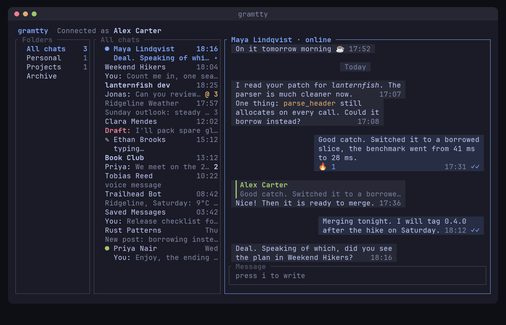

[Русский](README.ru.md)

# gramtty



Terminal Telegram client in Rust on TDLib.

## Contents

- [Features](#features)
- [Installation](#installation)
- [Runtime tools](#runtime-tools)
- [Telegram API credentials](#telegram-api-credentials)
- [First login](#first-login)
- [Key bindings](#key-bindings)
- [Configuration](#configuration)
- [License](#license)

## Features

- Login by QR code, phone number, login code, email code and 2FA password
- Chats, folders, forum topics, secret chats
- Chat list in two lines per chat, as in Telegram: the last message with its sender and time, drafts and who is typing; one line per chat with `appearance.compact_chat_list`. On a narrow terminal the chat info pane steps aside until you focus it (`4`), and `j` `k` scroll it when it is focused
- Inline media in the terminal: photos, albums, video, video notes, stickers, voice, files (kitty graphics; sixel, iTerm2 and half-block fallbacks); animated stickers and GIFs play right in the chat and in the sticker/GIF picker (natively in kitty; in sixel, iTerm2 and half-block terminals they are redrawn at up to 12 fps, at most 2 at a time in the chat, within about 1 MB/s of terminal output); video, video notes, GIFs, voice and music play with sound inside the viewer in kitty (libmpv), or in a separate mpv window
- Sending: files, albums, clipboard paste, voice messages, stickers and GIFs; upload progress and cancel
- Reactions, replies, edit, delete, forward, pin, copy, translate, save to Saved Messages
- Search like in Telegram: chats, contacts, public channels and messages in one box; search in a chat with highlighted matches, media filters, jump to a date and `n`/`N` stepping; pinned messages, notification inbox
- Jumps to the next unread chat, mention or reply, reaction
- Bot commands and inline keyboard buttons
- t.me links and @mentions open users, bots, channels, groups and messages right in gramtty; joining by an invite link and sending /start from a bot link ask first
- Desktop notifications and a notification sound
- Privacy: "don't mark as read", ghost mode (no online status, typing or read receipts)
- Opt-in, local-only history of messages deleted by others and earlier versions of edited ones (not kept for protected or secret chats)
- Themes (presets, including one that follows the terminal palette, and a custom `theme.toml`), six message layouts, border styles, avatar shapes
- Remappable keys

## Installation

Prebuilt binaries are published for:

| Platform | Needs |
|---|---|
| Linux x86_64 | glibc 2.39 or newer (Ubuntu 24.04, Debian 13, Fedora 40, Arch) |
| macOS Apple Silicon | macOS 15 or newer |
| macOS Intel | macOS 26 or newer |
| Windows x86_64 | Windows 10 1809 or newer; Windows Terminal 1.22 or newer recommended (sixel images) |

Any terminal works; kitty is recommended for images, animations and in-viewer video.

### Install script (Linux, macOS)

```
curl -fsSL https://raw.githubusercontent.com/methamphetaminelab/gramtty/main/scripts/install.sh | sh
```

Downloads the latest release, verifies its SHA-256 checksum and puts `gramtty` into `~/.local/bin`. Set `GRAMTTY_INSTALL_DIR` for another directory or `GRAMTTY_VERSION` (for example `1.1.0`) for a specific release.

### Windows

In PowerShell:

```
irm https://raw.githubusercontent.com/methamphetaminelab/gramtty/main/scripts/install.ps1 | iex
```

Downloads the latest release, verifies its SHA-256 checksum, puts `gramtty.exe` into `%LOCALAPPDATA%\Programs\gramtty`, adds it to `PATH` and installs mpv, ffmpeg and Windows Terminal with winget (mpv asks for administrator rights). Set `GRAMTTY_NO_DEPS=1` to skip the dependencies, `GRAMTTY_INSTALL_DIR` for another directory or `GRAMTTY_VERSION` for a specific release.

Or take the installer `gramtty-<version>-x86_64-windows-setup.exe` from the [releases page](https://github.com/methamphetaminelab/gramtty/releases/latest). It installs for the current user without administrator rights, adds a Start menu entry and `PATH`, can install the same dependencies, and is removed in Settings > Apps. The installer is not code-signed, so SmartScreen may ask for confirmation: More info > Run anyway.

Run `gramtty` in Windows Terminal: images use sixel there, the classic console only shows half-block pictures. Started from the Start menu or by double-click in the classic console, gramtty reopens itself in Windows Terminal; the installer and the install script install Windows Terminal or update it to 1.22 or newer. Dependencies installed later only show up in a new terminal window.

### Homebrew (macOS, Linux)

```
brew tap methamphetaminelab/gramtty https://github.com/methamphetaminelab/gramtty
brew install gramtty
```

### AUR (Arch Linux)

```
yay -S gramtty-bin   # prebuilt binary
yay -S gramtty       # build from source
```

Any AUR helper works (`paru -S ...`), or manually: `git clone https://aur.archlinux.org/gramtty-bin.git && cd gramtty-bin && makepkg -si`.

### Manual download

Take the archive for your platform from the [releases page](https://github.com/methamphetaminelab/gramtty/releases/latest), unpack it and put `gramtty` (`gramtty.exe` on Windows) somewhere on `PATH`.

### Build from source

```
cargo build --release
./target/release/gramtty
```

Needs Rust 1.99 or newer (`rust-version` in `Cargo.toml`). On Linux it also needs static `libc++.a` and `libc++abi.a` (TDLib is linked statically):

- Arch: `pacman -S libc++ libc++abi`
- Debian/Ubuntu: `apt install libc++-dev libc++abi-dev libclang-dev`
- Fedora: `dnf install libcxx-static libcxxabi-static`
- Other location: set `LIBCXX_DIR` to a directory containing both files

On Windows it needs Visual Studio Build Tools (C++ workload) and LLVM for `libclang` (`winget install LLVM.LLVM`).

## Runtime tools

All optional, looked up on `PATH`; a missing one only disables its feature.

| Used for | Linux | macOS | Windows |
|---|---|---|---|
| Playing media with sound inside the viewer (kitty only) | `libmpv` (`mpv` package), loaded dynamically | `libmpv` (`brew install mpv`) | not available (no kitty), `x` plays in mpv |
| Playing media in a separate window (`x`) | `mpv` | `mpv` | `mpv` (`winget install shinchiro.mpv`) |
| Video and sticker previews, inline WebM stickers and GIFs, upload thumbnails | `ffmpeg` | `ffmpeg` | `ffmpeg` (`winget install Gyan.FFmpeg`) |
| Probing media before upload | `ffprobe` | `ffprobe` | `ffprobe` (comes with ffmpeg) |
| Recording voice messages | `pw-record` (PipeWire) and `opusenc` or `ffmpeg` with libopus | `ffmpeg` (the terminal needs microphone permission) | `ffmpeg` with libopus; records from the first DirectShow microphone |
| Desktop notifications | `notify-send` (libnotify) | `osascript` (built in) | Windows PowerShell (built in) |
| Notification sound | `pw-play` or `canberra-gtk-play` | `afplay` (built in) | `mpv` |
| Clipboard copy and `Ctrl+V` paste | `wl-copy`, `wl-paste` (wl-clipboard) on Wayland; elsewhere (X11, SSH, tmux) copied text goes to the terminal clipboard (OSC 52), paste is Wayland only | `pbcopy`, `pbpaste` (built in); text only | Windows PowerShell (built in); files, images and text |
| Opening files and links externally | `xdg-open` | `open` (built in) | built in |

## Telegram API credentials

Prebuilt releases (install scripts, installer, Homebrew, `gramtty-bin`) come with built-in keys, so nothing is needed: just log in. Builds from source (including the `gramtty` AUR package) have no built-in keys; for them, or to use your own keys, get `api_id` and `api_hash` at https://my.telegram.org and put them in `~/.config/gramtty/api.toml` (on Windows `%APPDATA%\gramtty\api.toml`):

```toml
api_id = 12345
api_hash = "0123456789abcdef0123456789abcdef"
```

Or set both `GRAMTTY_API_ID` and `GRAMTTY_API_HASH` (they take priority over the file, the file over built-in keys). To build your own binary with built-in keys, set `GRAMTTY_BUILTIN_API_ID` and `GRAMTTY_BUILTIN_API_HASH` while running `cargo build`.

## First login

A QR code is shown. In Telegram open Settings > Devices > Link Desktop Device and scan it. Press `p` to log in with a phone number instead.

## Key bindings

Vim-style. `?` lists every key binding by context, your remaps included. `Space` is the leader key: press it and a popup lists every continuation (so do `g` and `]`).

| Key | Action |
|---|---|
| `?`, `Space ?` | all key bindings |
| `1` `2` `3` `4` | focus folders, chats, messages, chat info |
| `Tab` `h` `l` | next or previous pane |
| `j` `k`, arrows, `Ctrl-n` `Ctrl-p` | move |
| `Ctrl-d` `Ctrl-u`, `PgDn` `PgUp` | scroll |
| `J` `K` | scroll the messages without moving the selection |
| `gg` `G` | top, bottom |
| `/` | filter the pane; in messages, search the chat |
| `Enter` | open chat or topic; on a message, its action menu |
| `Space Space` | search: chats, contacts, public channels and bots, messages |
| `Space /` | search messages in all chats |
| `n` `N` | next (older) / previous (newer) result of the chat search |
| `i` | compose; in a group or channel you haven't joined, join it. Where you can't write, the composer says why |
| `Enter` / `Shift-Enter` or `Alt-Enter` or `Ctrl-j` | send / newline (in the composer) |
| `Esc` | leave the composer; the text and the reply stay as a draft, synced with Telegram when you switch chats. Outside it, clear marks, drop the reply, close the filter or deselect the message |
| `R` `e` `d` | reply, edit, delete |
| `r` `f` `y` `P` | react, forward, copy text, pin or unpin |
| `m` | mark or unmark a message; `f` `y` `d` then act on all marked ones |
| `V` | select part of the message text to copy |
| `o` | open a link or @mention from the message (with several, pick one from a list); t.me links and mentions open inside gramtty, other links in the browser |
| `v` / `x` | view attachment (media plays inside it) / play in mpv or open |
| in the viewer: `Space` `←` `→` `↑` `↓` `m` | pause, seek ∓5 s, volume ±5, mute |
| `Space u` | attach file (composer: `Ctrl-o`) |
| `Space v` | record voice message (composer: `Ctrl-r`) |
| `Space s` | stickers and GIFs (composer: `Ctrl-s`, `Ctrl-g`) |
| `Space k` | bot buttons (composer: `Ctrl-k`) |
| `]u` `]m` `]r` | next unread chat, mention or reply, reaction |
| `gp`, `Space P` | jump to pinned message, list pinned messages |
| `Space n` | notification inbox |
| `Space m` | mark chat read |
| `Space p` | profile |
| `Space g` | shared media: photos, videos, files, links, voice, GIFs, music |
| `Space a` | actions for the selected message, or for the selected chat: mute, pin, archive, leave or delete it and more |
| `Space 1` `2` `4` | toggle folders, chats, info panes |
| `Space r` | redraw |
| `Space M` | recent notices and errors |
| `Space o` | options |
| `Space L` | log out |
| `q` | quit (asks first while files upload or a voice message records); in a popup, close it |
| `Ctrl-c` | quit |

Keys are remapped in `~/.config/gramtty/keymap.toml`, under `[keymap]`: `leader = "<C-x>"`, `ReplyMessage = "<leader>R"`, `Quit = false` to unbind. `?` shows every action with its name for this file, and `gramtty --print-keymap` prints the same list in the terminal.

### Search

`Space Space` opens one search box, as in Telegram. While you type it shows:

- **Chats and contacts**: your chats (archived ones too) and contacts, by name or @username. Case and accents don't matter, `ё` and `е` are the same, every word can be typed from its start in any order, and a query typed in the wrong keyboard layout (`ghbdtn` for `привет`) still finds the chat
- **Global search**: public channels, groups, bots and people you haven't talked to yet
- **Messages**: messages from all chats, newest first, with the match highlighted; more load as you scroll down

With an empty query it shows recently found chats and the top of the chat list. `↑` `↓` move, `Tab` `Shift-Tab` jump between sections, `Enter` opens the chat, starts a chat with a contact or jumps to the message. A public channel or group you haven't joined opens as a preview; `Alt-Enter` joins it. `Space /` opens the same box for messages only.

`/` in the messages pane searches the open chat as you type. `Tab` `Shift-Tab` pick a media type (photos, videos, files, links, voice, GIFs, music), `Backspace` on an empty query drops the media or sender filter, and a date like `2024-05-01` or `01.05.2024` offers to go to that day. `Enter` jumps to the selected message and keeps the search: `n` `N` step to the next (older) and previous (newer) result right in the chat, `/` reopens the list where you left it, `Esc` in the list ends the search. In the lists of shared media and of messages from a member (`a` in a profile), `/` starts a text search inside that list.

## Configuration

Files in `~/.config/gramtty/` (`$XDG_CONFIG_HOME` is honoured):

- `api.toml`: API credentials
- `config.toml`: settings; `Space o` edits and saves it. Sections: `[notifications]`, `[privacy]`, `[appearance]`, `[navigation]`, `[chats]`, `[media]`. Unknown keys are rejected. In `[media]`, `animations = "all" | "selected" | "off"` chooses which stickers and GIFs move (`"off"` keeps them still, useful on slow terminals), `max_animations` caps how many play at once in the chat, `pause_unfocused` stops them while the terminal is not focused
- `theme.toml`: custom theme, used when `appearance.theme = "custom"`. Reloaded on save, no restart needed
- `keymap.toml`: key bindings

Data (TDLib database, logs, deleted-message history, upload staging): `~/.local/share/gramtty` (`$XDG_DATA_HOME`, or `GRAMTTY_DATA_DIR` to override).

On Windows the files live in `%APPDATA%\gramtty`, data in `%LOCALAPPDATA%\gramtty\data`, cache in `%LOCALAPPDATA%\gramtty\cache`.

`gramtty --print-theme [terminal|default|high-contrast|light|mono|custom]` prints a theme as TOML, a starting point for `theme.toml`. `Space o` > "Write theme.toml" saves the current theme there.

Main options:

- `notifications.desktop`, `sound`, `volume` (0-100), `sound_file`: notifications and their sound
- `privacy.dont_mark_read`, `ghost_mode`: read receipts and online status
- `privacy.keep_deleted`, `keep_deleted_limit` (default 5000): local history of deleted and edited messages
- `privacy.hide_blocked`, `hide_stories`, `hide_phone`
- `appearance.theme`: `terminal` (default), `default`, `high-contrast`, `light`, `mono`, `custom`
- `appearance.layout`: `classic`, `cards`, `compact`, `minimal`, `split`, `bubbles` (default)
- `appearance.border_style`, `avatar_shape`, `seconds`, `show_ids`, `exact_numbers`
- `appearance.folder_counter` (`chats`, `messages`, `off`), `folder_counter_unmuted_only`, `hide_all_chats`, `compact_chat_list` (one line per chat, without the last message)
- `navigation.open_chat_focus` (`smart`, `composer`, `messages`), `after_send_next_unread`, `skip_muted`
- `chats.translate_to`, `photos_as_files`, `save_to_chat`

Image protocol is detected from the terminal; force it with `GRAMTTY_IMAGE_PROTOCOL` = `auto`, `kitty`, `sixel`, `iterm2` or `halfblocks`.

## License

GPL-3.0-or-later, see `LICENSE`. The notification sound is from Telegram Desktop (GPL-3.0); see `NOTICE`.
