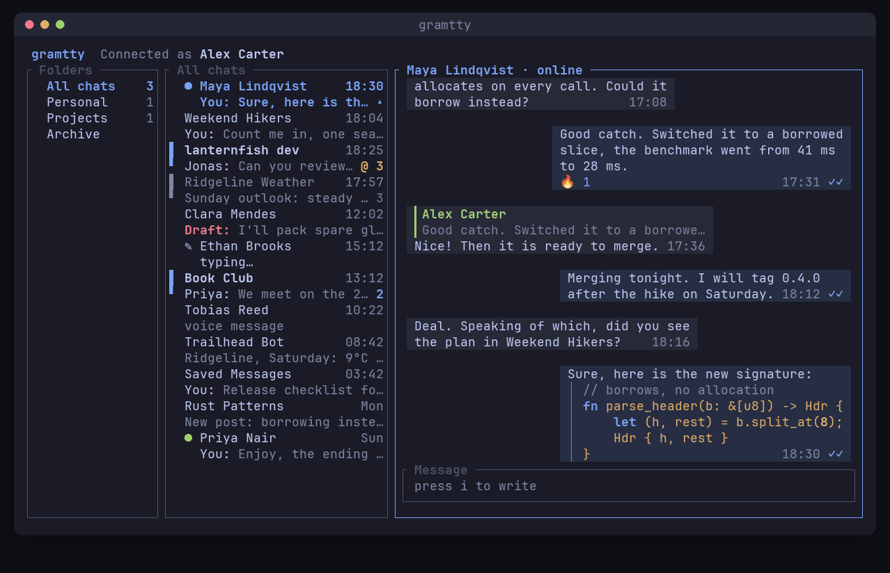

[English](README.md)

# gramtty



Терминальный клиент Telegram на Rust и TDLib.

## Содержание

- [Возможности](#возможности)
- [Установка](#установка)
- [Утилиты времени выполнения](#утилиты-времени-выполнения)
- [Ключи Telegram API](#ключи-telegram-api)
- [Первый вход](#первый-вход)
- [Клавиши](#клавиши)
- [Настройка](#настройка)
- [Лицензия](#лицензия)

## Возможности

- Вход по QR-коду, номеру телефона, коду из Telegram, коду с почты и паролю 2FA
- Чаты, папки, топики форумов, секретные чаты
- Список чатов в две строки, как в Telegram: последнее сообщение с отправителем и временем, черновики и кто печатает; одна строка на чат с `appearance.compact_chat_list`. В узком терминале панель информации о чате уступает место, пока на неё не перейти (`4`), а `j` `k` прокручивают её, когда она в фокусе
- Медиа прямо в терминале: фото, альбомы, видео, кружки, стикеры, голосовые, файлы (графика kitty; запасные варианты sixel, iTerm2 и полублоки); анимированные стикеры и GIF играют прямо в чате и в выборе стикеров и GIF (в kitty средствами самого терминала; в терминалах с sixel, iTerm2 и полублоками перерисовываются не чаще 12 кадров в секунду, в чате не больше двух сразу, вывод в терминал до 1 МБ/с); видео, кружки, GIF, голосовые и музыка играют со звуком прямо в просмотрщике в kitty (libmpv) или в отдельном окне mpv
- Отправка: файлы, альбомы, вставка из буфера обмена, голосовые, стикеры и GIF; прогресс загрузки и отмена
- Реакции, ответы, редактирование, удаление, пересылка, закрепление, копирование, перевод, сохранение в «Избранное»
- Поиск как в Telegram: чаты, контакты, публичные каналы и сообщения в одном окне; поиск в чате с подсветкой совпадений, фильтрами по типу медиа, переходом к дате и шагами `n`/`N`; закреплённые сообщения, центр уведомлений
- Переходы к следующему непрочитанному чату, упоминанию или ответу, реакции
- Команды ботов и кнопки inline-клавиатуры
- Ссылки t.me и @упоминания открывают пользователей, ботов, каналы, группы и сообщения прямо в gramtty; перед вступлением по ссылке-приглашению и перед отправкой /start по ссылке бота gramtty спрашивает подтверждение
- Уведомления на рабочем столе и звук уведомления
- Форматирование при наборе: жирный, курсив, подчёркивание, зачёркивание, спойлер, код, ссылки и цитаты сразу видны в поле ввода; меню «Format» по `Ctrl-t`; при правке отправленного сообщения разметка сохраняется
- Подсветка синтаксиса в блоках кода, копирование блока кода по `Y`, набор сообщения в `$EDITOR` по `Ctrl-x`
- Фоновый плеер для голосовых и музыки: очередь, скорость, MPRIS (медиаклавиши, `playerctl`) на Linux
- Локальная офлайн-расшифровка голосовых и кружков через whisper (`T`)
- Два чата рядом (`Ctrl-w v`)
- Управление запущенным клиентом из командной строки (`gramtty send`, `unread`, `chats`, `open`) и хуки на сообщения
- «Открыть», «Прочитано» и «Ответить» прямо из уведомления (Linux)
- Приватность: «не отмечать прочитанным», режим призрака (нет статуса онлайн, «печатает» и отметок о прочтении)
- Локальная история сообщений, удалённых другими, и прежних версий изменённых; включается вручную (для защищённых и секретных чатов не ведётся)
- Темы (пресеты, в том числе следующий палитре терминала, и свой `theme.toml`), шесть раскладок сообщений, стили рамок, формы аватарок
- Переназначаемые клавиши

## Установка

Готовые бинарники публикуются для:

| Платформа | Что нужно |
|---|---|
| Linux x86_64 | glibc 2.39 или новее (Ubuntu 24.04, Debian 13, Fedora 40, Arch) |
| macOS на Apple Silicon | macOS 15 или новее |
| macOS на Intel | macOS 26 или новее |
| Windows x86_64 | Windows 10 1809 или новее; рекомендуется Windows Terminal 1.22 или новее (картинки sixel) |

Подойдёт любой терминал; для изображений, анимаций и видео в просмотрщике рекомендуется kitty.

### Скрипт установки (Linux, macOS)

```
curl -fsSL https://raw.githubusercontent.com/methamphetaminelab/gramtty/main/scripts/install.sh | sh
```

Скачивает последний релиз, сверяет контрольную сумму SHA-256 и кладёт `gramtty` в `~/.local/bin`. Другой каталог задаётся через `GRAMTTY_INSTALL_DIR`, конкретная версия через `GRAMTTY_VERSION` (например `1.1.0`).

### Windows

В PowerShell:

```
irm https://raw.githubusercontent.com/methamphetaminelab/gramtty/main/scripts/install.ps1 | iex
```

Скачивает последний релиз, сверяет контрольную сумму SHA-256, кладёт `gramtty.exe` в `%LOCALAPPDATA%\Programs\gramtty`, добавляет его в `PATH` и ставит mpv, ffmpeg и Windows Terminal через winget (mpv попросит права администратора). `GRAMTTY_NO_DEPS=1` пропускает зависимости, `GRAMTTY_INSTALL_DIR` задаёт другой каталог, `GRAMTTY_VERSION` конкретную версию.

Или скачайте установщик `gramtty-<версия>-x86_64-windows-setup.exe` на [странице релизов](https://github.com/methamphetaminelab/gramtty/releases/latest). Он ставит программу для текущего пользователя без прав администратора, добавляет ярлык в меню «Пуск» и `PATH`, умеет поставить те же зависимости, а удаляется через «Параметры» > «Приложения». Установщик не подписан, поэтому SmartScreen может переспросить: «Подробнее» > «Выполнить в любом случае».

Запускайте `gramtty` в Windows Terminal: там картинки идут через sixel, в старой консоли только полублоками. Если gramtty запущен из меню «Пуск» или двойным щелчком и открылся в старой консоли, он сам переоткроется в Windows Terminal; установщик и скрипт установки ставят Windows Terminal или обновляют его до 1.22 и новее. Зависимости, поставленные позже, видны только в новом окне терминала.

### Homebrew (macOS, Linux)

```
brew tap methamphetaminelab/gramtty https://github.com/methamphetaminelab/gramtty
brew install gramtty
```

### AUR (Arch Linux)

```
yay -S gramtty-bin   # готовый бинарник
yay -S gramtty       # сборка из исходников
```

Подойдёт любой AUR-помощник (`paru -S ...`) или вручную: `git clone https://aur.archlinux.org/gramtty-bin.git && cd gramtty-bin && makepkg -si`.

### Скачать вручную

Возьмите архив для своей платформы на [странице релизов](https://github.com/methamphetaminelab/gramtty/releases/latest), распакуйте и положите `gramtty` (на Windows `gramtty.exe`) в каталог из `PATH`.

### Сборка из исходников

```
cargo build --release
./target/release/gramtty
```

Нужен Rust 1.99 или новее (`rust-version` в `Cargo.toml`). На Linux также нужны статические `libc++.a` и `libc++abi.a` (TDLib линкуется статически):

- Arch: `pacman -S libc++ libc++abi`
- Debian/Ubuntu: `apt install libc++-dev libc++abi-dev libclang-dev`
- Fedora: `dnf install libcxx-static libcxxabi-static`
- Другое расположение: `LIBCXX_DIR` указывает на каталог с обоими файлами

На Windows нужны Visual Studio Build Tools (набор для C++) и LLVM ради `libclang` (`winget install LLVM.LLVM`).

## Утилиты времени выполнения

Все необязательны и ищутся в `PATH`; без утилиты не работает только её функция.

| Для чего | Linux | macOS | Windows |
|---|---|---|---|
| Воспроизведение со звуком прямо в просмотрщике (только kitty) | `libmpv` (пакет `mpv`), загружается динамически | `libmpv` (`brew install mpv`) | недоступно (нет kitty), `x` играет в mpv |
| Воспроизведение в отдельном окне (`x`) | `mpv` | `mpv` | `mpv` (`winget install shinchiro.mpv`) |
| Превью видео и стикеров, WebM-стикеры и GIF в чате, миниатюры при отправке | `ffmpeg` | `ffmpeg` | `ffmpeg` (`winget install Gyan.FFmpeg`) |
| Анализ медиа перед отправкой | `ffprobe` | `ffprobe` | `ffprobe` (идёт с ffmpeg) |
| Запись голосовых | `pw-record` (PipeWire) и `opusenc` или `ffmpeg` с libopus | `ffmpeg` (терминалу нужен доступ к микрофону) | `ffmpeg` с libopus; пишет с первого микрофона DirectShow |
| Уведомления на рабочем столе | `notify-send` (libnotify) | `osascript` (встроен) | Windows PowerShell (встроен) |
| Звук уведомления | `pw-play` или `canberra-gtk-play` | `afplay` (встроен) | `mpv` |
| Копирование и вставка `Ctrl+V` | `wl-copy`, `wl-paste` (wl-clipboard) в Wayland; в остальных случаях (X11, SSH, tmux) скопированный текст уходит в буфер обмена терминала (OSC 52), вставка только в Wayland | `pbcopy`, `pbpaste` (встроены); только текст | Windows PowerShell (встроен); файлы, картинки и текст |
| Открытие файлов и ссылок во внешней программе | `xdg-open` | `open` (встроен) | встроено |

## Ключи Telegram API

В готовых сборках (скрипты установки, установщик, Homebrew, `gramtty-bin`) ключи уже встроены, ничего делать не нужно: просто войдите. В сборках из исходников (включая AUR-пакет `gramtty`) встроенных ключей нет; для них, или чтобы пользоваться своими ключами, получите `api_id` и `api_hash` на https://my.telegram.org и положите в `~/.config/gramtty/api.toml` (на Windows `%APPDATA%\gramtty\api.toml`):

```toml
api_id = 12345
api_hash = "0123456789abcdef0123456789abcdef"
```

Либо задайте обе переменные `GRAMTTY_API_ID` и `GRAMTTY_API_HASH` (они приоритетнее файла, файл приоритетнее встроенных ключей). Чтобы собрать свой бинарник со встроенными ключами, задайте `GRAMTTY_BUILTIN_API_ID` и `GRAMTTY_BUILTIN_API_HASH` при `cargo build`.

## Первый вход

Показывается QR-код. В Telegram откройте Настройки > Устройства > Подключить устройство и отсканируйте его. Чтобы войти по номеру телефона, нажмите `p`.

## Клавиши

Как в vim. `?` показывает все привязки по разделам, с учётом ваших переназначений. `Space` это лидер: после нажатия всплывает список всех продолжений (так же у `g` и `]`).

| Клавиша | Действие |
|---|---|
| `?`, `Space ?` | все привязки клавиш |
| `1` `2` `3` `4` | фокус: папки, чаты, сообщения, информация о чате |
| `Tab` `h` `l` | следующая или предыдущая панель |
| `j` `k`, стрелки, `Ctrl-n` `Ctrl-p` | движение |
| `Ctrl-d` `Ctrl-u`, `PgDn` `PgUp` | прокрутка |
| `J` `K` | прокрутить сообщения, не двигая выбор |
| `gg` `G` | в начало, в конец |
| `/` | фильтр панели; в сообщениях поиск по чату |
| `Enter` | открыть чат или топик; на сообщении меню действий |
| `Space Space` | поиск: чаты, контакты, публичные каналы и боты, сообщения |
| `Space /` | поиск сообщений во всех чатах |
| `n` `N` | следующий (более старый) / предыдущий (более новый) результат поиска по чату |
| `i` | писать сообщение; в группе или канале, где вас нет, вступить. Где писать нельзя, вместо поля ввода написано почему |
| `Enter` / `Shift-Enter`, `Alt-Enter` или `Ctrl-j` | отправить / перенос строки (в поле ввода) |
| `Esc` | выйти из поля ввода; текст и ответ остаются черновиком и синхронизируются с Telegram при переходе в другой чат. Вне поля ввода снять отметки, отменить ответ, закрыть фильтр или снять выбор с сообщения |
| `R` `e` `d` | ответить, изменить, удалить |
| `r` `f` `y` `P` | реакция, переслать, копировать текст, закрепить или открепить |
| `m` | отметить сообщение или снять отметку; `f` `y` `d` затем работают со всеми отмеченными |
| `V` | выделить часть текста сообщения и скопировать |
| `o` | открыть ссылку или @упоминание из сообщения (если их несколько, выбрать из списка); t.me и упоминания открываются в gramtty, остальные ссылки в браузере |
| `v` / `x` | посмотреть вложение (медиа играет в нём) / воспроизвести в mpv или открыть |
| в просмотрщике: `Space` `←` `→` `↑` `↓` `m` | пауза, перемотка ∓5 с, громкость ±5, без звука |
| `Space u` | прикрепить файл (в поле ввода: `Ctrl-o`) |
| `Space v` | записать голосовое (в поле ввода: `Ctrl-r`) |
| `Space s` | стикеры и GIF (в поле ввода: `Ctrl-s`, `Ctrl-g`) |
| `Space k` | кнопки бота (в поле ввода: `Ctrl-k`) |
| `]u` `]m` `]r` | следующий непрочитанный чат, упоминание или ответ, реакция |
| `gp`, `Space P` | к закреплённому сообщению, список закреплённых |
| `Space n` | центр уведомлений |
| `Space m` | отметить чат прочитанным |
| `Space p` | профиль |
| `Space g` | общие медиа: фото, видео, файлы, ссылки, голосовые и кружки, GIF, музыка |
| `Space a` | действия для выбранного сообщения или чата: выключить уведомления, закрепить, архивировать, выйти или удалить и другое |
| `Space 1` `2` `4` | показать или скрыть панели папок, чатов, информации |
| `Space r` | перерисовать экран |
| `Space M` | последние уведомления и ошибки |
| `Space o` | настройки |
| `Space L` | выйти из аккаунта |
| `q` | выход (сначала спросит, если идёт загрузка файлов или запись голосового); во всплывающем окне закрыть его |
| `Ctrl-c` | выход |

Клавиши переназначаются в `~/.config/gramtty/keymap.toml`, секция `[keymap]`: `leader = "<C-x>"`, `ReplyMessage = "<leader>R"`, `Quit = false` снимает привязку. `?` показывает все действия с их именами для этого файла, а `gramtty --print-keymap` печатает тот же список в терминал.

### Поиск

`Space Space` открывает одно окно поиска, как в Telegram. По мере ввода в нём появляются:

- **Чаты и контакты**: ваши чаты (и архивные) и контакты, по имени или @username. Регистр и диакритика не важны, `ё` и `е` считаются одной буквой, любое слово можно набирать с начала и в любом порядке, а запрос, набранный не в той раскладке (`ghbdtn` вместо `привет`), всё равно найдёт чат
- **Глобальный поиск**: публичные каналы, группы, боты и люди, с которыми вы ещё не переписывались
- **Сообщения**: сообщения из всех чатов, сначала новые, совпадение подсвечено; при прокрутке вниз подгружаются следующие

С пустым запросом видны недавно найденные чаты и начало списка чатов. `↑` `↓` двигают выбор, `Tab` `Shift-Tab` переходят между разделами, `Enter` открывает чат, начинает чат с контактом или переходит к сообщению. Публичный канал или группа, где вас нет, открывается для просмотра; `Alt-Enter` вступает. `Space /` открывает то же окно только для сообщений.

`/` в панели сообщений ищет по открытому чату по мере ввода. `Tab` `Shift-Tab` выбирают тип медиа (фото, видео, файлы, ссылки, голосовые, GIF, музыка), `Backspace` в пустом запросе снимает фильтр по типу или отправителю, а дата вида `2024-05-01` или `01.05.2024` предлагает перейти к этому дню. `Enter` переходит к выбранному сообщению и не закрывает поиск: `n` `N` переходят к следующему (более старому) и предыдущему (более новому) результату прямо в чате, `/` снова открывает список на том же месте, `Esc` в списке завершает поиск. В списках общих медиа и сообщений участника (`a` в профиле) `/` включает поиск по тексту внутри списка.

### Форматирование сообщений

Разметка видна прямо в поле ввода (сами маркеры приглушены).

| Синтаксис | Результат |
|---|---|
| `**текст**` | жирный |
| `__текст__` | курсив |
| `<u>текст</u>` | подчёркнутый |
| `~~текст~~` | зачёркнутый |
| `\|\|текст\|\|` | спойлер |
| `` `код` `` | код в строке |
| ```` ```язык ```` ... ```` ``` ```` на отдельных строках | блок кода, язык необязателен |
| `[текст](https://example.com)` | ссылка |
| `[имя](tg://user?id=123)` | упоминание по id |
| `> текст` (одна или несколько строк) | цитата |
| `\*` | сам символ маркера |

После открывающего маркера и перед закрывающим не должно быть пробела, а `__` работает только на границах слов, поэтому `my__var__name`, `2 ** 3` и `a * b * c` остаются как есть. Внутри кода ничего не разбирается.

`Shift`+стрелки, `Shift-Home` `Shift-End` и `Ctrl-Shift-←` `→` выделяют текст в поле ввода. `Ctrl-t` открывает меню Format: `b` жирный, `i` курсив, `u` подчёркнутый, `s` зачёркнутый, `p` спойлер, `c` код, `k` блок кода, `l` ссылка, `q` цитата, `x` убрать форматирование. Если есть выделение, оно оборачивается (повторно снимается); если нет, вставляются маркеры и курсор встаёт между ними. При правке отправленного сообщения (`e`) его разметка показывается и сохраняется; исключение одно: курсив, который начинается или кончается посреди слова.

`Ctrl-x` в поле ввода открывает текст в `$VISUAL` или `$EDITOR` (можно с аргументами, например `code --wait`; если ни одна не задана, в первом установленном из nano, nvim, vim и vi; в Windows nvim, vim, nano, затем Блокнот); если редактор вернулся быстрее секунды и текст не изменился, черновик остаётся, а в статусе просят команду, которая ждёт; после выхода из редактора текст заменяет черновик и сам не отправляется.

Блоки кода с языком (rust, python, js/ts, go, c/c++, java, kotlin, bash/sh, json, toml, yaml, sql, diff) подсвечиваются цветами темы. `Y` на сообщении копирует код без ограждений; если блоков несколько, открывается список.

### Фоновый плеер

`v` на голосовом или аудиофайле запускает его в фоне; следующие голосовые и кружки (или аудиофайлы) чата встают в очередь. Строка внизу показывает состояние, название, время, прогресс, скорость и место в очереди; очередь играет и после перехода в другой чат. Видео, кружки и фото по-прежнему открываются в просмотрщике, `x` по-прежнему открывает mpv. Нужен `libmpv`; без него `v` играет в mpv.

`Space .` пауза, `Space x` стоп, `Space ]` `Space [` следующий и предыдущий, `Space h` `Space l` перемотка на 5 с, `Space >` скорость 1×, 1.25×, 1.5×, 2×. Скорость голосовых запоминается (`media.voice_speed`, проценты 100-200); музыка всегда начинается с 1×.

На Linux gramtty регистрирует `org.mpris.MediaPlayer2.gramtty`, так что работают медиаклавиши и `playerctl -p gramtty play-pause`; `media.mpris = false` это выключает.

### Расшифровка голосовых

`T` на голосовом или кружке расшифровывает его локально программой распознавания речи и показывает текст под сообщением; `T` ещё раз скрывает. Одновременно идёт одна расшифровка; текст появляется по ходу работы, с прогрессом (проценты, а если длина неизвестна, секунды). Пункт меню и подсказка `T` видны, только когда программа найдена или задан `command`. `/` в чате находит и текст уже сделанных расшифровок. Определяются сами: `whisper-ctranslate2`, затем `whisper` (openai-whisper). Любая другая программа задаётся в конфиге; она должна печатать текст в stdout (каждая строка показывается сразу):

```toml
[transcription]
command = ["whisper-cli", "-m", "/path/model.bin", "-nt", "-f", "{file}"]
language = "ru"
```

Это пример для whisper.cpp, его нужно подогнать: он читает WAV, поэтому нужна обёртка с конвертацией через ffmpeg. `{file}` заменяется скачанным файлом, `{lang}` языком (или `auto`). Расшифровки хранятся в `transcripts.json` в каталоге данных (не больше 5000); для секретных чатов и чатов с защищённым содержимым они остаются только в памяти.

### Два чата рядом

`Ctrl-w v` оставляет текущий чат боковой панелью; в активной панели другой чат открывается как обычно. `Ctrl-w w` переключает панели (у каждой своя прокрутка, выделение и черновик), `Ctrl-w f` пересылает выбранное или отмеченные сообщения в чат другой панели, `Ctrl-w q` закрывает активную панель (вторая остаётся). `Tab`/`Shift-Tab`, `h`/`l` и `3` ходят по обеим панелям сообщений как по панелям ряда. Щелчок по другой панели переводит на неё фокус. Сплиту нужно не меньше 100 колонок под сообщения; в узком терминале рисуется только активная панель, а в её заголовке видно `[split: <другой чат>]`. Сообщения в боковой панели не помечаются прочитанными, пока вы на неё не перейдёте. Те же действия есть под `Space w` (`Space w v`, `w`, `q`, `f`).

### Командная строка и хуки

Пока gramtty запущен, эти команды обращаются к нему через локальный сокет (Linux и macOS; на Windows пока нет):

```
gramtty send me "купить молоко"
git diff | gramtty send me --code diff
gramtty send "Team chat" --file ./report.pdf "отчёт за неделю"
gramtty unread --json
gramtty chats
gramtty open @someone
```

`<chat>` это `me` (Избранное), числовой id, @username, который gramtty уже знает, или название чата (сначала точное, потом частичное; несколько совпадений считаются ошибкой). Текст отправляется как есть и делится по 4096 символов; `--code [язык]` отправляет его блоком кода. `queued` в ответе значит, что запущенный клиент принял сообщение, а не что Telegram его доставил. Сокет: `$XDG_RUNTIME_DIR/gramtty.sock` (в каталоге данных, если задан `GRAMTTY_DATA_DIR`), права 0600.

`unread --json` печатает `{"total":{"chats":2,"messages":5,"mentions":1},"chats":[{"id":10,"title":"Team","unread":3,"mentions":1,"muted":false}]}`, это удобно для панели состояния; `chats --json` печатает `{"chats":[{"id":1,"title":"Alice","kind":"private","username":"alice"}]}`.

Хук запускает команду на каждое входящее сообщение:

```toml
[hooks]
on_message = ["/home/me/bin/on-message.sh"]
```

Команда задаётся списком аргументов, запускается без оболочки и получает на stdin одну строку JSON: `chat_id`, `chat_title`, `chat_kind`, `sender_id`, `sender_name`, `message_id`, `date`, `text`, `media`, `muted`, `mention`. Одновременно работает не больше 4 хуков (лишние события отбрасываются), каждый останавливается через 10 с, ошибки видны в `Space M`.

### Действия в уведомлениях

На Linux у уведомления три действия: щелчок открывает чат на этом сообщении, «Mark as read» помечает чат прочитанным (даже при «не отмечать прочитанным»), «Reply» спрашивает текст в небольшом окне (fuzzel, rofi, wofi, zenity или kdialog, первое найденное) и отправляет его. Если такой программы нет, gramtty открывает чат и начинает ответ. Нужен `notify-send` с `--action`; покажутся ли кнопки, зависит от демона уведомлений. `notifications.actions = false` их выключает; `notifications.reply_command = ["fuzzel", "--dmenu", "--prompt-only=Reply to {title}: "]` задаёт своё окно ввода.

## Настройка

Файлы в `~/.config/gramtty/` (учитывается `$XDG_CONFIG_HOME`):

- `api.toml`: ключи API
- `config.toml`: настройки; `Space o` меняет и сохраняет его. Секции: `[notifications]`, `[privacy]`, `[appearance]`, `[navigation]`, `[chats]`, `[media]`, `[hooks]`, `[transcription]`. Неизвестные ключи отвергаются. В `[media]` ключ `animations = "all" | "selected" | "off"` выбирает, какие стикеры и GIF двигаются (`"off"` оставляет их неподвижными, это помогает на медленных терминалах), `max_animations` ограничивает, сколько их играет в чате одновременно, `pause_unfocused` останавливает их, пока окно терминала не в фокусе
- `theme.toml`: своя тема, работает при `appearance.theme = "custom"`. Перечитывается при сохранении, перезапуск не нужен
- `keymap.toml`: клавиши

Данные (база TDLib, логи, история удалённых сообщений, временные файлы отправки): `~/.local/share/gramtty` (`$XDG_DATA_HOME`, либо `GRAMTTY_DATA_DIR`).

На Windows файлы лежат в `%APPDATA%\gramtty`, данные в `%LOCALAPPDATA%\gramtty\data`, кэш в `%LOCALAPPDATA%\gramtty\cache`.

`gramtty --print-theme [terminal|default|high-contrast|light|mono|custom]` печатает тему в TOML, это основа для `theme.toml`. `Space o` > «Write theme.toml» сохраняет текущую тему туда же.

Основные параметры:

- `notifications.desktop`, `sound`, `volume` (0-100), `sound_file`: уведомления и их звук
- `privacy.dont_mark_read`, `ghost_mode`: отметки о прочтении и статус онлайн
- `privacy.keep_deleted`, `keep_deleted_limit` (по умолчанию 5000): локальная история удалённых и изменённых сообщений
- `privacy.hide_blocked`, `hide_stories`, `hide_phone`
- `appearance.theme`: `terminal` (по умолчанию), `default`, `high-contrast`, `light`, `mono`, `custom`
- `appearance.layout`: `classic`, `cards`, `compact`, `minimal`, `split`, `bubbles` (по умолчанию)
- `appearance.border_style`, `avatar_shape`, `seconds`, `show_ids`, `exact_numbers`
- `appearance.folder_counter` (`chats`, `messages`, `off`), `folder_counter_unmuted_only`, `hide_all_chats`, `compact_chat_list` (одна строка на чат, без последнего сообщения)
- `navigation.open_chat_focus` (`smart`, `composer`, `messages`), `after_send_next_unread`, `skip_muted`
- `chats.translate_to`, `photos_as_files`, `save_to_chat`

Протокол изображений определяется по терминалу; принудительно: `GRAMTTY_IMAGE_PROTOCOL` = `auto`, `kitty`, `sixel`, `iterm2` или `halfblocks`.

## Лицензия

GPL-3.0-or-later, см. `LICENSE`. Звук уведомления взят из Telegram Desktop (GPL-3.0); см. `NOTICE`.
